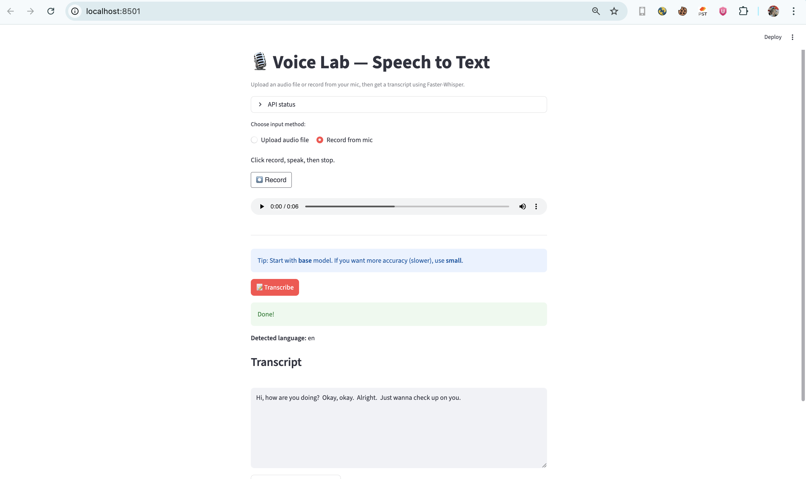
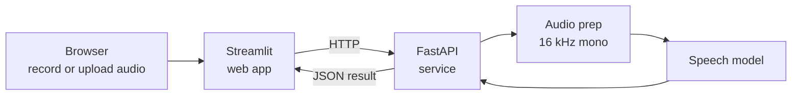

# Voice AI Portfolio


**Five working speech AI applications, each with its own API and web app.**

Each project takes a different speech problem: turning speech into text, checking who is speaking, recognising
voice commands, splitting a recording by speaker, and recognising accents. Each one goes beyond a notebook: the
model runs behind a FastAPI service, and a Streamlit web app lets anyone record their voice or upload a file and
see the result.



---

## The projects

| # | Project | What it does | Model | |
|---|---|---|---|---|
| 1 | **[Speech-to-Text](Speech-to-Text-Web-App)** | Turns recorded or uploaded speech into text, detects the language, and lets you download the transcript | Faster-Whisper | Pretrained |
| 2 | **[Speaker Verification](Speaker%20Verification%20(Voice%20Login%20System))** | A voice login: enrol your voice once, then prove it's you by speaking | SpeechBrain ECAPA-TDNN | Pretrained |
| 3 | **[Keyword Spotting](Keyword%20Spotting%20(Voice%20Commands))** | Recognises short voice commands: yes, no, up, down, left, right, stop, go | Small CNN on MFCC features | **Trained by me** |
| 4 | **[Speaker Diarization](Speaker%20Diarization)** | Works out who spoke when in a meeting or interview, with time stamps you can download | pyannote.audio 3.1 | Pretrained |
| 5 | **[Accent Classification](Accent%20Classification%20(Speech%20Accent%20Recognition))** | Predicts a speaker's accent from a short clip, with the top three guesses | wav2vec2 with a classifier head | **Fine-tuned by me** |

Each folder has its own README with full setup steps, and screenshots for the speech-to-text and voice login
projects.

---

## How each project is built

All five follow the same pattern, so the model, the service and the user interface stay separate:



- **Streamlit web app:** records from the microphone or takes an uploaded file, and shows the result.
- **FastAPI service:** prepares the audio, runs the model and returns the result. Each service has a `/health`
  check and interactive API docs at `/docs`, so it can be used by other apps too, not just the web page.
- **Runs on a normal laptop:** everything works on a CPU. A GPU is optional.

---

## A closer look

### 1. Speech-to-Text
Uses Faster-Whisper (the `base` model by default, running in 8-bit to save memory). It accepts wav, mp3, m4a, aac
and ogg files, detects the language automatically and lets you download the transcript as a text file.

### 2. Speaker Verification (voice login)

/images/verified.png)

When you enrol, the system turns your voice into a voiceprint (a list of numbers that describes how you sound)
using a SpeechBrain model trained on thousands of speakers. To log in, it makes a new voiceprint and compares the
two. If they are similar enough (0.75 by default, adjustable with a slider), you are verified. Users can be listed
and deleted from the app.

### 3. Keyword Spotting (voice commands)
I trained this model myself on Google's Speech Commands dataset. Each one-second clip is turned into MFCC
features (a compact picture of the sound), and a small convolutional neural network picks one of ten answers:
the eight commands, "unknown word" or "silence". The model is small enough for real-time use on a CPU.

### 4. Speaker Diarization (who spoke when)
Uses the pyannote.audio 3.1 pipeline to split a long recording into segments by speaker, for example
`[0.0 to 12.4] Speaker_0`, `[12.4 to 25.2] Speaker_1`. You can set the minimum and maximum number of speakers,
and download the results as text or JSON. It needs a free Hugging Face access token because the model is gated.

### 5. Accent Classification
Built with transfer learning. A pretrained wav2vec2 speech model turns the clip into features, and I trained a
small classifier on top. It learns whichever accents it is given a folder of clips for; the example setup uses
British, American, Nigerian, Indian and Australian. Only the small classifier is trained, so it needs little data
and trains quickly on a CPU.

---

## Getting started

Each project is set up and run on its own. The steps are the same for all five:

```bash
git clone https://github.com/sparobanks/Complete-AI-Voice-Projects.git
cd "Complete-AI-Voice-Projects/Speech-to-Text-Web-App"     # or any other project folder

conda create -n voice_lab python=3.10 -y
conda activate voice_lab
pip install -r requirements.txt

# 1. Start the API (each project uses its own port, see the table below)
python -m uvicorn api.main:app --host 127.0.0.1 --port 8002

# 2. In a second terminal, start the web app
streamlit run app/Home.py
```

Then open http://localhost:8501.

| Project | API port | Extra steps |
|---|---|---|
| Speech-to-Text | 8002 | FFmpeg must be installed |
| Speaker Verification | 8003 | None |
| Keyword Spotting | 8004 | Train first: `python scripts/train.py` (downloads the dataset) |
| Speaker Diarization | 8005 | Set `HF_TOKEN` to your Hugging Face token |
| Accent Classification | 8006 | Add clips to `data/raw/<accent>/`, then run `scripts/prepare_data.py` and `scripts/train.py` |

On macOS, if you see an OpenMP error, run `export KMP_DUPLICATE_LIB_OK=TRUE` before starting the API.

---

## Tech stack

| Area | Tools |
|---|---|
| Speech models | Faster-Whisper, SpeechBrain, pyannote.audio, wav2vec2 (Hugging Face Transformers) |
| Deep learning | PyTorch, Torchaudio |
| Services | FastAPI, Uvicorn |
| Web apps | Streamlit, streamlit-audiorecorder |
| Audio | FFmpeg, pydub, SoundFile |
| Data | NumPy, pandas, scikit-learn |

---

## Limitations and next steps

- **No published accuracy figures yet.** The apps have been tested by hand with real recordings, but the results
  have not been measured on a standard test set. That is the next step for each project.
- **Accent classification** is trained on a small dataset, so it should be treated as a demo. It has not been checked for bias between accents.
- **Voice login** has no protection against recorded or AI-generated voices, so it is not secure enough for real
  logins yet.
- **Planned:** combine speech-to-text with diarization to produce transcripts labelled by speaker, add
  measured results to each README, and deploy the apps online.

---

## Author

**Jasper Chinedu Nwangere** ([@sparobanks](https://github.com/sparobanks)), AI/ML Engineer ·
[LinkedIn](https://www.linkedin.com/in/sparobanks/)
